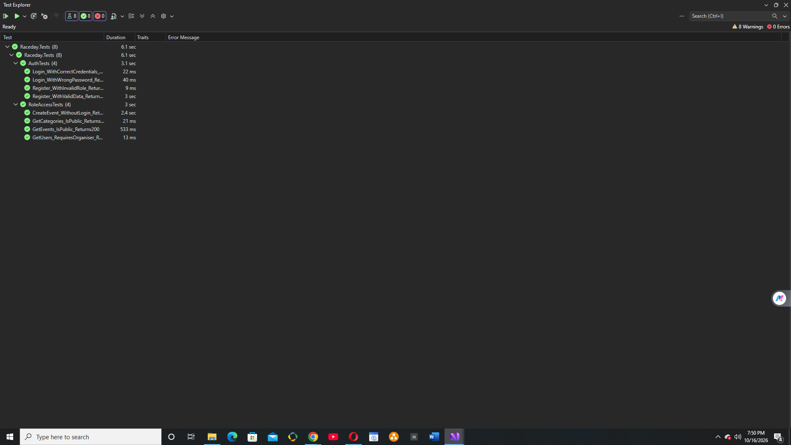

# RaceDay API — PROG6212 Part 2

ASP.NET Core Web API for the RaceDay event management system, built as part of PROG6212 (Programming 2B) at IIE.

## 👤 Student Information

- **Name:** Lungile
- **Student Number:** ST10477114
- **Module:** PROG6212 — Programming 2B
- **Institution:** The Independent Institute of Education (IIE)

## 🎯 Project Overview

The RaceDay system connects **Organisers** who create and manage running events with **Participants** who enrol in them. The API handles:

- User registration and login (session-based authentication)
- Role-based access control (Organiser vs Participant)
- Event and category management
- Event enrolments
- Race results
- Weather information per event

## 🛠️ Tech Stack

| Layer | Technology |
|---|---|
| Framework | ASP.NET Core 10 Web API |
| ORM | Entity Framework Core (Code-First) |
| Database | SQL Server Express (`.\SQLEXPRESS`) |
| Authentication | Custom session-based auth handler |
| API Docs | Swagger / OpenAPI |
| Testing | xUnit, FluentAssertions, In-Memory EF |
| CI/CD | GitHub Actions |

## 📂 Project Structure
## 🧪 Unit Tests

The test project (`Raceday.Tests`) uses xUnit with an in-memory database. Tests run in under 6 seconds.

### Test Coverage

**AuthTests (4):**
- ✅ Register with valid data returns 201
- ✅ Register with invalid role returns 400
- ✅ Login with wrong password returns 401
- ✅ Login with correct credentials returns 200

**RoleAccessTests (4):**
- ✅ Create event without login returns 401
- ✅ Get events is public and returns 200
- ✅ Get categories is public and returns 200
- ✅ Get users without login returns 401

### Test Results

